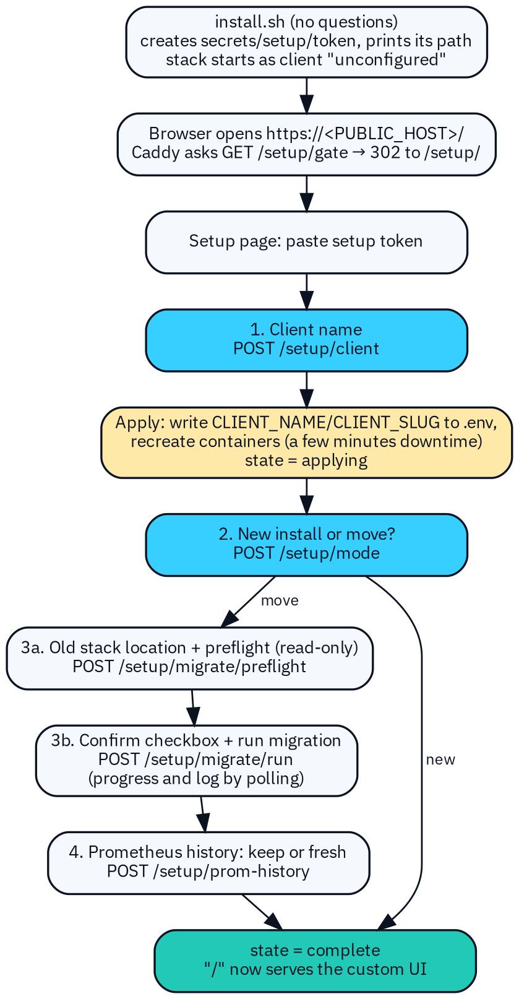
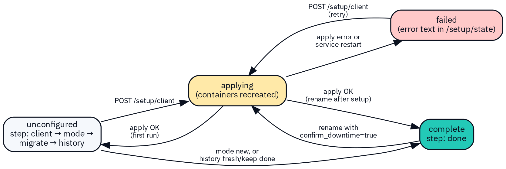
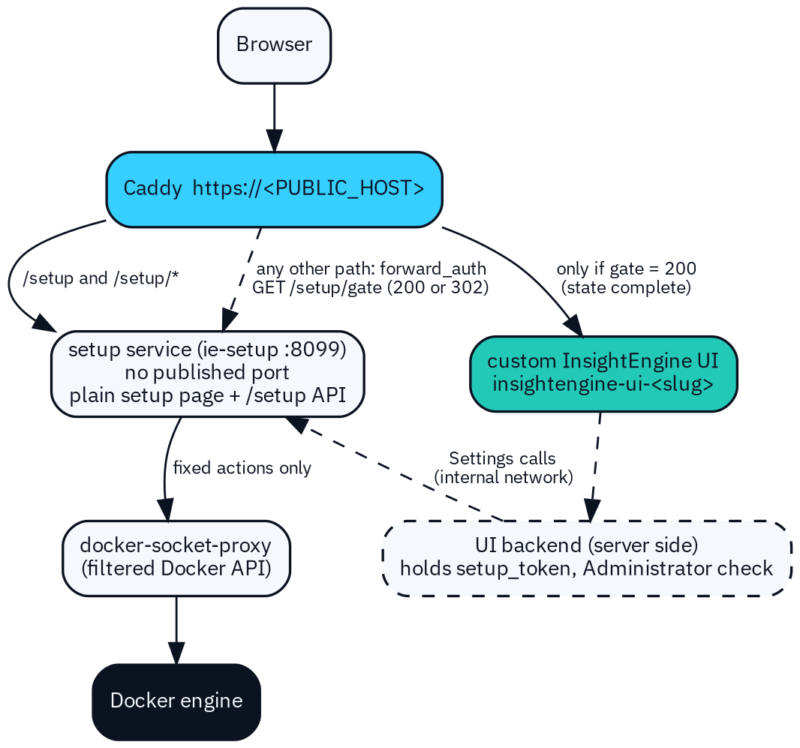

# NTT InsightEngine – First-run setup: notes for the custom UI developer

Notes for the developer of the custom InsightEngine UI. From: Phindani Gama (network engineer). Status: draft for review.

The UI source now lives in `ui/` of this repository. `git clone`, then `./install.sh`, then open `https://<PUBLIC_HOST>/`. That address is the first-run page (`/setup/`) until setup is complete, then the Next.js UI. `IE_UI_IMAGE` empty builds `insightengine-ui:local` from `ui/Dockerfile` (port 8080).

Everything here comes from the stack bundle (docs/setup-api.md, which is the authority for the API, plus the README, install.sh, .env.example, Caddyfile and docker-compose.yml) and from me. Anything that is a proposal and not yet in the bundle starts with “Suggested:”. Things not decided yet are in section 13, Open items.

# 1. Purpose and what you need to know first

InsightEngine is **one client per server**: it is installed on one monitoring server at one client’s site. It is sized, as an estimate, for about 20,000 devices per client. It replaces my old Docker Compose monitoring stack.

- install.sh asks **no questions**. It writes CLIENT_NAME='unconfigured', creates the setup token file secrets/setup/token, prints only that file’s path, and starts the stack.

- The first time someone opens the web address, a **first-run setup page** appears before the main UI. The main UI stays locked until setup is complete.

- We built the setup page and its API ourselves. They are plain HTML and JavaScript served by a small **setup service**, so first-run works **before your UI exists**.

What I need from you:

1.  **Do not break the setup page.** Do not replace, restyle or proxy around /setup and /setup/\*.

2.  **Reuse its API** for the Settings pages (client name, Move from old stack, Prometheus history, status and log).

3.  **Take over the same address** once setup is complete. Your UI replaces the placeholder container insightengine-ui. On load, your UI checks the setup state and sends the user to /setup/ if setup is not complete.

# 2. What is in the stack

| **Part** | **What it does (short)** |
|----|----|
| Caddy | TLS front door. Sends the address to the setup page or to your UI (section 5). |
| Setup service (ie-setup) | First-run page and /setup API. Only part allowed to recreate containers (through a filtered Docker proxy). |
| Prometheus, snmp-exporter, snmp-generator, blackbox-exporter | Metrics collection: SNMP, ping/probes. |
| Alertmanager (+ alert-relay webhook) | Alert routing. The relay forwards alerts to webhook destinations. |
| Grafana | Dashboards. |
| Telegraf | API collector (firewalls, controllers), host metrics, syslog. |
| NetBox, Netdisco | Inventory and source of truth; discovery. NetBox moved off “/” to its own port PORT_NETBOX (8444). |
| Activepieces | Automation; replaces n8n (n8n flows are not migrated). |
| Loki, Oxidized, SNMP trap receiver | Syslog storage, config backups, traps (optional profiles). |
| PostgreSQL (one per app) | netbox-postgres, activepieces-postgres, netdisco-postgres, insightengine-postgres. |

# 3. The first-run flow, step by step

*Figure 1 – First-run flow (README section 2.2, setup-api.md section 2).*

**1. Token.** The operator opens `https://<PUBLIC_HOST>[:PORT_HTTPS]/setup/` and pastes the setup token, read on the server with sudo cat secrets/setup/token. The page keeps it in memory only (section 6.1).

**2. Client name.** POST /setup/client. The service writes the name into .env and recreates every container except itself and the Docker proxy. That means **a few minutes of downtime**. The page keeps polling and shows “Waiting for the service (containers may be restarting)” while Caddy restarts.

**3. New install or move.** POST /setup/mode with new finishes setup. move opens the migration steps.

**4. Move from the old stack.** Enter the old stack’s location and file paths, then run the read-only **preflight** (dry run). Show its report, then the user must tick “I confirm: copy the data into the new stack (the old stack is only read)”. Only then can **Run migration** start. Progress and log are polled.

**5. Prometheus history.** Keep the old history (optional import) or start fresh. Either choice completes setup.

Rules that the UI must state clearly:

- The old stack is **only read**. It is never stopped, changed or deleted. The new and old stacks can run side by side.

- Database **passwords are never typed** into the UI. The user gives the path of a file that contains the password.

- **Rollback:** nothing in the old stack was changed, so rollback means keep using the old stack. To drop the new one: docker compose down **without** -v, and restore the old ports if they were moved.

# 4. Setup state values

Figure 2 – Setup states and the calls that move between them.

| **state** | **Meaning** | **What the UI shows** |
|----|----|----|
| unconfigured | Setup not finished. step says where the user is. | Setup page only. Your UI redirects to /setup/. |
| applying | Client name saved; containers are being recreated. | Progress and log; all buttons disabled; expect the connection to drop for a while. |
| complete | Setup done (step = done). | Your UI. Setup page is no longer reachable through Caddy (section 5). |
| failed | The apply step failed, or the service restarted during it. error has the reason. | Error message, log, and a retry (send the client name again). |

While unconfigured, step names the next call: client → POST /setup/client; mode → POST /setup/mode; migrate → POST /setup/migrate/preflight, then /run; history → POST /setup/prom-history.

Background **jobs** have their own state: running, succeeded or failed, and a kind: apply, preflight, migrate or prom-history. **Only one job runs at a time.** A second action returns HTTP 409. A failed preflight, migration or history import fails only the job; it does not set the setup state to failed.

# 5. Routing: who serves the address

*Figure 3 – Routing in the Caddyfile, and the internal path for Settings calls (setup-api.md section 3).*

- /setup and /setup/* always go to the setup service.
- Every other path: Caddy first asks the setup service GET /setup/gate. **200** (state complete) → your UI. Anything else (302 to /setup/) goes back to the browser. If the setup service is down, “/” returns an error (fails closed).
- **Your UI must also check on load:** call GET /setup/state **without a token** (it returns only state and step). If state is not complete, do location.replace('/setup/'). The placeholder page in config/ui-placeholder/index.html shows exactly this.
- After setup is complete, the setup service answers **only** /setup/state, /setup/gate and /setup/healthz through Caddy (unless SETUP_PUBLIC_AFTER_COMPLETE=yes). Everything else returns 404 on the public address.
- So your Settings pages call **your own backend**. It holds the token as the secret mount setup_token, checks that the user is an Administrator, and calls http://setup:8099/setup/... on monitoring-net. Internal callers are not affected by the lockdown. The browser never sees the token.
- Your UI container is `insightengine-ui-<slug>`. With `IE_UI_IMAGE` empty, the image is built from `ui/Dockerfile`. `IE_UI_PORT` defaults to 8080. The container is recreated, with the new name, every time the client name is applied.

# 6. Setup API contract

Base path /setup. JSON in and out (Content-Type: application/json, request body up to 64 KB). Responses carry Cache-Control: no-store. Names and shapes follow docs/setup-api.md (the authority), implemented in setup/server.py. Browser base URL https://\<PUBLIC_HOST\>/setup; internal base URL http://setup:8099/setup.

## 6.1 Authentication

- Every call except /setup/ (page files), /setup/healthz, /setup/gate and /setup/state without a header needs Authorization: Bearer \<setup token\>.

- install.sh creates a random token in secrets/setup/token (mode 0400/0600) and prints only the file path. It is mounted as /run/secrets/setup_token, and is never logged, returned or put in the page.

- Ten failed attempts per minute from one address → HTTP 429 for the rest of that minute. To rotate: write a new value to the file, then docker compose restart setup.

- After setup, your backend may hold the token as the setup_token secret mount. Admin-only access to the Settings screens is your UI’s job (role check), in addition to the token. How users sign in to your UI is still open (Open item 1).

## 6.2 Polling and progress

- After any call that returns **202** (a job started), poll GET /setup/state (with token) every **3 seconds**, as the setup page does. For preflight, migration and history import jobs, also poll GET /setup/migrate/status. Refresh GET /setup/log?lines=200 for the log view.

- Stop polling when job.state is succeeded or failed and state is not applying.

- Network errors while applying are **expected** (Caddy and your UI are being recreated). Keep retrying quietly; do not show a hard error.

- A running job survives a page reload: on load, read /setup/state and resume polling if job.state is running. There is no cancel call.

## 6.3 Errors

Every error is HTTP 4xx/5xx with one JSON shape: {"error": "\<plain text message\>"}. Show the message as is; it never contains secrets.

| **HTTP** | **When** |
|----|----|
| 400 | Bad input: invalid client name, unknown field, path not under the old-stack mount, confirm missing. |
| 401 | Missing or wrong token. Ask for the token again. |
| 404 | Unknown path, or a blocked path after setup is complete. |
| 409 | Wrong state for this call, another action is running, preflight not passed, settings changed since preflight, or a rename without confirm_downtime. |
| 413 / 429 / 500 | Body over 64 KB / too many failed token attempts / internal error (details only in the server log). |

## 6.4 Endpoints

| **Method and path** | **Auth** | **Purpose** | **Success** |
|----|----|----|----|
| GET /setup/ | no | The plain first-run page (+ app.js, style.css). | 200 HTML |
| GET /setup/healthz | no | Liveness check. | 200 |
| GET /setup/gate | no | Used by Caddy: complete or not. | 200 or 302 |
| GET /setup/state | optional | No token: state, step. With token: full state. | 200 |
| POST /setup/client | yes | Save client name and apply (recreate containers). | 202 + job |
| POST /setup/mode | yes | new or move. | 200 |
| POST /setup/migrate/preflight | yes | Save old-stack settings and start the read-only preflight. | 202 + job |
| POST /setup/migrate/run | yes | Start the migration after a passing preflight. | 202 + job |
| GET /setup/migrate/status | yes | Job, preflight result, progress steps, log tail. | 200 |
| POST /setup/prom-history | yes | keep (import job) or fresh. | 200 or 202 |
| GET /setup/log?lines=N | yes | Last N lines of the setup log (1–1000, default 200). | 200 |

## 6.5 Example requests and responses

All values in the examples (names, IDs, times, paths) are made up. Times are in UTC, as the API sends them.

GET /setup/state (no token) — Example data – illustrative only

> {"state": "unconfigured", "step": "client"}

GET /setup/state (with token) — Example data – illustrative only

> {
>
> "state": "unconfigured", "step": "migrate",
>
> "client_name": "Example Client Ltd", "client_slug": "example-client-ltd",
>
> "mode": "move", "history": null, "migrated": false, "error": null,
>
> "updated_at": "2026-10-24T15:41:03Z",
>
> "job": {"id": "3f2a9c1b7d4e", "kind": "apply", "state": "succeeded",
>
> "started": "2026-10-24T15:37:10Z", "finished": "2026-10-24T15:40:58Z",
>
> "exit_code": 0, "error": null},
>
> "last_preflight": null
>
> }

GET /setup/gate — Example data – illustrative only

> 200 {"state": "complete"}
>
> 302 Location: /setup/ (when not complete)

POST /setup/client — Example data – illustrative only

> Request: {"client_name": "Example Client Ltd"}
>
> (rename after setup: add "confirm_downtime": true)
>
> Response: 202 {"state": "applying", "job_id": "3f2a9c1b7d4e",
>
> "client_name": "Example Client Ltd", "client_slug": "example-client-ltd"}

Client name rules (enforced by the service): 1–60 characters; no quotes, \$, backticks, backslashes or control characters; at least one letter or digit; it cannot be “unconfigured”. The slug is the name in lower case with other characters turned into “-”, up to 40 characters.

POST /setup/mode — Example data – illustrative only

> Request: {"mode": "move"} ("new" finishes setup)
>
> Response: 200 {"state": "unconfigured", "step": "migrate"}
>
> (for "new": 200 {"state": "complete", "step": "done"}; 409 if the name is not applied yet)

POST /setup/migrate/preflight — Example data – illustrative only

> Request: {"old_stack": {
>
> "compose_file": "/opt/arg/docker-compose.yml",
>
> "netbox_pg_container": "netbox-postgres",
>
> "netbox_db": "netbox", "netbox_db_user": "netbox",
>
> "netbox_db_password_file": "/opt/arg/secrets/netbox_db_password",
>
> "netdisco_pg_container": "netdisco-postgres",
>
> "netbox_media_path": "/opt/arg/netbox/netbox/media",
>
> "grafana_data_path": "/opt/arg/grafana",
>
> "alertmanager_config_path": "/opt/arg/alertmanager/alertmanager.yml",
>
> "caddyfile_path": "/opt/arg/caddy/Caddyfile",
>
> "keep_dumps": true }}
>
> Response: 202 {"job_id": "a1b2c3d4e5f6", "preflight_id": "a1b2c3d4e5f6"}

Required: netbox_pg_container and netbox_db_password_file. Other accepted fields: stack_dir, netbox_container, netdisco_db, netdisco_db_user, netdisco_db_password_file, grafana_provisioning_path, grafana_container, prom_container. Every path must be absolute, contain no .., lie under SETUP_OLD_STACK_ROOT (default /opt, mounted read-only) and not inside the install folder. Unknown fields are rejected. Allowed in the move flow (step migrate or history) or when state is complete (Settings).

POST /setup/migrate/run — Example data – illustrative only

> Request: {"preflight_id": "a1b2c3d4e5f6", "confirm": true}
>
> Response: 202 {"job_id": "0c9d8e7f6a5b"}

GET /setup/migrate/status — Example data – illustrative only

> {
>
> "job": {"id": "0c9d8e7f6a5b", "kind": "migrate", "state": "running",
>
> "started": "2026-10-24T15:52:00Z", "finished": null, "exit_code": null, "error": null},
>
> "preflight": {"id": "a1b2c3d4e5f6", "passed": true, "errors": 0, "warnings": 1,
>
> "time": "2026-10-24T15:47:31Z", "conf_sha256": "9b1e…"},
>
> "preflight_log": "data/migration/migrate-20261024-154702.log",
>
> "progress": \[
>
> {"time": "2026-10-24T15:52:01Z", "step": "prepare", "state": "done", "detail": ""},
>
> {"time": "2026-10-24T15:52:40Z", "step": "netbox-db", "state": "running", "detail": ""}
>
> \],
>
> "log_tail": \["2026-10-24T15:52:40Z step netbox database: dump (old, read-only) -\> restore (new)"\]
>
> }

progress is the last 100 lines of data/migration/progress.json; log_tail is the last 40 lines of the setup log. Step names are defined by scripts/migrate.sh (today: preflight, prepare, netbox-db, netdisco-db, grafana, config-review, complete, plus fatal). state: running, done, failed (preflight: passed/failed). Show them as a checklist.

POST /setup/prom-history — Example data – illustrative only

> Request: {"mode": "fresh"}
>
> Response: 200 {"state": "complete", "step": "done"}
>
> Request: {"mode": "keep", "method": "snapshot",
>
> "old_url": "http://host.docker.internal:9090",
>
> "old_data_dir": "/opt/arg/prometheus/data"}
>
> (method "dir" copies complete blocks; no old_url needed)
>
> Response: 202 {"job_id": "7e6d5c4b3a29"}

Poll GET /setup/migrate/status for the keep job. Tell the user: “snapshot” needs --web.enable-admin-api on the old Prometheus, reachable from the setup container (host.docker.internal maps to the host). “dir” loses about the last 2 hours. Only the new Prometheus is stopped during the copy (short gap in new graphs).

GET /setup/log?lines=200 and an error — Example data – illustrative only

> 200 {"lines": \["2026-10-24T15:37:10Z render: .env \<- client 'Example Client Ltd' (example-client-ltd)",
>
> "2026-10-24T15:37:11Z \$ docker compose ... config --services"\],
>
> "size": 18342}
>
> 409 {"error": "another action is running"}

## 6.6 What applying the client name changes

| **Where** | **Uses the client name or slug** |
|----|----|
| Containers | \<service\>-\<slug\>, all recreated except ie-setup and ie-docker-proxy. Fixed project name insightengine, so volumes insightengine\_\<volume\> keep their data. |
| Prometheus | external_labels client and client_name. After a rename, new series carry the new label; old series keep the old one. |
| NetBox | Tenant and root region from the client name, created by scripts/seed-netbox.sh after setup. Not renamed automatically on a rename (README TODO). |
| Grafana / Alertmanager | Grafana folder “InsightEngine - \<name\>”; Alertmanager notification titles. |
| Single store | data/setup/config.json holds the client identity; every apply copies it to CLIENT_NAME/CLIENT_SLUG in .env. Nobody edits these in .env by hand. |
| Caddy, Loki | Caddy site names, certificate names and X-Client header; Loki/syslog client label. |

# 7. Security rules for the setup service

- **The web UI never gets Docker access.** Not the socket, not the Docker API, not shell commands. Your UI only calls the backend API.

- Only the setup service can change containers. It has **no published port**, and its only Docker access is through docker-socket-proxy, which blocks image build, secrets, swarm, system and other API families.

- The service runs a **fixed set of actions** (render .env, compose up, migrate.sh, prom-history.sh); no endpoint runs an arbitrary command. Old-stack folders are mounted **read-only**; passwords are file paths only.

- The setup page has a strict Content-Security-Policy (own scripts only, no inline code). No secrets in front-end code, URLs, local storage or logs.

- Still a risk: the proxy filters by API family, not by project, so a holder of the setup token could act as root on the host. Keep the token server-side. The service can be stopped after setup (docker compose stop setup docker-socket-proxy), which disables rename and move.

- Suggested: every Settings action that calls the setup API is written to your audit log with user and time.

# 8. What the custom UI must build (Settings)

The setup page stays as the fallback. In your UI, the Settings area reuses the same API (through your backend, see section 5):

| **Settings item** | **Build** | **API** |
|----|----|----|
| Client name | Show the current name and slug. Rename = warning about several minutes of downtime (estimate) and the label side effects (section 6.6) + checkbox, then progress. | GET /setup/state, POST /setup/client with confirm_downtime: true |
| Move from old stack (button) | Same flow as first run: location form → preflight report → checkbox “I understand the old stack is only read; data is copied” → run → progress and log. Show the rollback note; afterwards, tell the user to recreate NetBox API tokens (scripts/set-secret.sh). | /setup/migrate/preflight, /run, /status |
| Prometheus history | Keep or start fresh; for keep, method, old URL and old data folder. | POST /setup/prom-history |
| Status and log | Current state, last job, errors, log viewer with refresh. | GET /setup/state, GET /setup/log?lines=500 |
| Database tab (read-only) | Each app’s database and its tables. No editing. | None yet (Open item 2) |
| Alertmanager webhook page | Manage webhook destinations for the alert relay (destinations.json). URLs can contain secrets. Suggested: show them masked. | None yet (Open item 2) |
| Users and roles | User-based views and roles (below). | Your backend |

Suggested roles (to be confirmed):

| **Role** | **Setup / migration / rename** | **Settings view** | **Webhooks** | **Monitoring screens** |
|----|----|----|----|----|
| Administrator | Yes | Yes | Edit | Yes |
| Engineer | No | Yes (read-only) | View | Yes |
| Operator | No | No | No | Yes |
| Read-only | No | No | No | View only |

# 9. UI states

| **State** | **Setup page and Settings panels** |
|----|----|
| Empty / not started | Short explanation and the first input. Nothing pre-filled except saved values from /setup/state. |
| Running | Buttons disabled; progress checklist; log with the newest line visible; “containers may be restarting” note during applying. |
| Error | The error text from the API, the log, and the one action that fixes it (retry, rerun preflight, re-enter token). |
| Success | Clear done message; for first run, a link to “/”. For migration, the follow-up steps (recreate NetBox API tokens, merge old Alertmanager routes by hand). |
| Locked | Your UI while not complete: never render data, always redirect to /setup/. |

# 10. Accessibility and branding

- Follow the NTT InsightEngine brand in the design pack: Midnight Navy \#0B1220 background, Signal Cyan \#36CFFF accent, Intelligence Teal \#23C9B7 secondary accent, Cloud White \#F5F8FC text, the N/E monogram, IBM Plex Sans and IBM Plex Mono (use Mono for logs and JSON).

- The product name is InsightEngine everywhere. Do not use names of other monitoring products in user-facing text.

- Never show state by colour alone: always text or an icon too. Accessible contrast, full keyboard use, real labels on every input.

- Suggested: announce progress and errors with an aria-live region, and move focus to the new step heading when the step changes.

- Do not edit the plain setup page (setup/static/). Its look stays simple on purpose; we own it.

# 11. Testing without the real stack

- **Option A – real service, fake Docker.** setup/tests/test_setup_api.py (10 tests) runs the real setup/server.py against a stub docker command in a temporary folder (python3 setup/tests/test_setup_api.py). It proves the API and state logic only.

- **Option B – Suggested: a small mock** that you run beside your dev server. The example below answers with the section 6.5 shapes; extend it with the other endpoints.

mock_setup.py — Example data – illustrative only (Suggested)

> \# Mock of the setup API for UI work. Example data only. python3 mock_setup.py
>
> import json, time
>
> from http.server import BaseHTTPRequestHandler, ThreadingHTTPServer
>
> S = {"state": "unconfigured", "step": "client", "client_name": "unconfigured",
>
> "client_slug": "unconfigured", "until": 0}
>
> TOKEN = "mock-token"
>
> class H(BaseHTTPRequestHandler):
>
> def out(self, code, obj, loc=None):
>
> b = json.dumps(obj).encode(); self.send_response(code)
>
> if loc: self.send_header("Location", loc)
>
> self.send_header("Content-Type", "application/json")
>
> self.send_header("Content-Length", str(len(b))); self.end_headers(); self.wfile.write(b)
>
> def tick(self): \# "applying" ends 20 s after POST /setup/client
>
> if S\["state"\] == "applying" and time.time() \> S\["until"\]:
>
> S.update(state="unconfigured", step="mode")
>
> def do_GET(self):
>
> self.tick(); p = self.path.split("?")\[0\]
>
> if p == "/setup/gate":
>
> if S\["state"\] == "complete":
>
> return self.out(200, {"state": "complete"})
>
> return self.out(302, {}, "/setup/")
>
> if p == "/setup/state":
>
> pub = {"state": S\["state"\], "step": S\["step"\]}
>
> if self.headers.get("Authorization") == "Bearer " + TOKEN:
>
> pub.update(client_name=S\["client_name"\], client_slug=S\["client_slug"\])
>
> return self.out(200, pub)
>
> if self.headers.get("Authorization") != "Bearer " + TOKEN:
>
> return self.out(401, {"error": "missing or invalid token"})
>
> self.out(404, {"error": "not found"})
>
> def do_POST(self):
>
> self.tick(); n = int(self.headers.get("Content-Length") or 0)
>
> body = json.loads(self.rfile.read(n) or b"{}")
>
> if self.headers.get("Authorization") != "Bearer " + TOKEN:
>
> return self.out(401, {"error": "missing or invalid token"})
>
> if self.path == "/setup/client":
>
> S.update(state="applying", client_name=body.get("client_name", ""),
>
> client_slug="example-client", until=time.time() + 20)
>
> return self.out(202, {"state": "applying", "job_id": "3f2a9c1b7d4e",
>
> "client_name": S\["client_name"\], "client_slug": "example-client"})
>
> if self.path == "/setup/mode" and body.get("mode") == "new":
>
> S.update(state="complete", step="done")
>
> return self.out(200, {"state": "complete", "step": "done"})
>
> self.out(409, {"error": "another action is running"})
>
> ThreadingHTTPServer(("127.0.0.1", 8099), H).serve_forever()

Test these cases against the mock: (1) “/” redirects to /setup/, and /setup/state without a token returns only state and step; (2) a client name gives applying for about 20 seconds with failed requests in between, then step mode; (3) a wrong token gives 401, a 409 shows as a plain message, and failed shows the retry; (4) mode new gives complete, your UI loads, and a reload during a job resumes polling.

# 12. Checklist for “done”

> ☐ /setup and /setup/\* still reach the plain setup page; nothing in your build or proxy shadows them.
>
> ☐ Your UI calls GET /setup/state on load and redirects to /setup/ unless state is complete.
>
> ☐ Your UI runs as the insightengine-ui service image (IE_UI_IMAGE, IE_UI_PORT) and survives being recreated with a new name.
>
> ☐ No Docker access, no setup token and no secrets in the browser; Settings calls go through your backend, which reads the setup_token secret.
>
> ☐ Every endpoint in section 6.4 used by Settings handles 400, 401, 404, 409, 429 and 500.
>
> ☐ Empty, running, error, success and locked states exist for every Settings panel; the section 11 mock cases pass.
>
> ☐ Rename asks for the downtime confirmation and sends confirm_downtime: true.
>
> ☐ Migration needs a passing preflight and the confirm checkbox before Run is enabled; rollback note shown.
>
> ☐ Polling every 3 seconds, quiet retry during applying, resume after reload.
>
> ☐ Brand colours and fonts applied; keyboard and screen-reader checks pass; no colour-only states.
>
> ☐ Only Administrators can start setup, migration, history import or rename.

# 13. Open items

| **\#** | **Item** | **Status** |
|----|----|----|
| 1 | Settings access after setup: the internal backend path is defined (section 5), but sign-in to your UI, the identity provider and the role check are not decided, nor whether the setup service is stopped after setup (that disables rename and move). | Open |
| 2 | No API yet for the Database tab (each app’s database and tables) or the Alertmanager webhook page (who writes config/alert-relay/destinations.json). | Open |
| 3 | Error shape: the setup API sends {"error": "text"}; the design pack’s Insight API uses {"error": {"code", "message"}}. Pick one. | Open |
| 4 | Docker proxy risk: root-equivalent for whoever holds the setup token (section 7). I need to accept it or reduce it. | Open |
| 5 | Untested and draft (README sections 9 and 11): the bundle is review-only; no container was started; Caddy forward_auth, the proxy allow-list, the page in a browser and real migrations are untested; UI-placeholder and proxy image tags are unverified. | Open |
